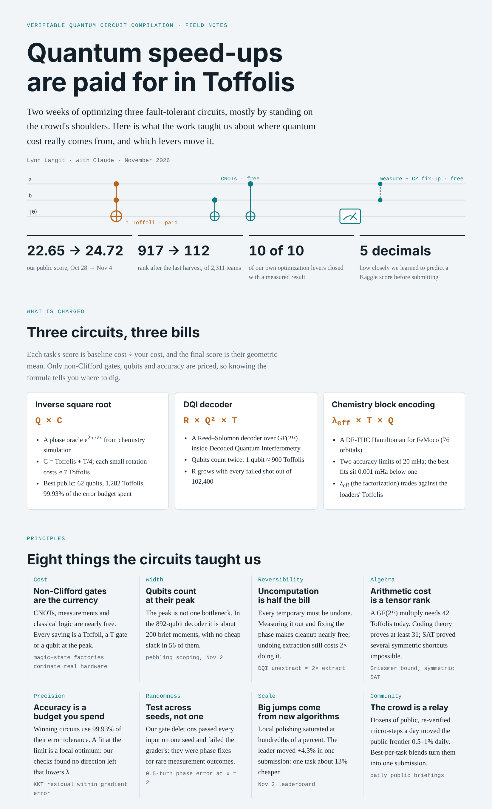
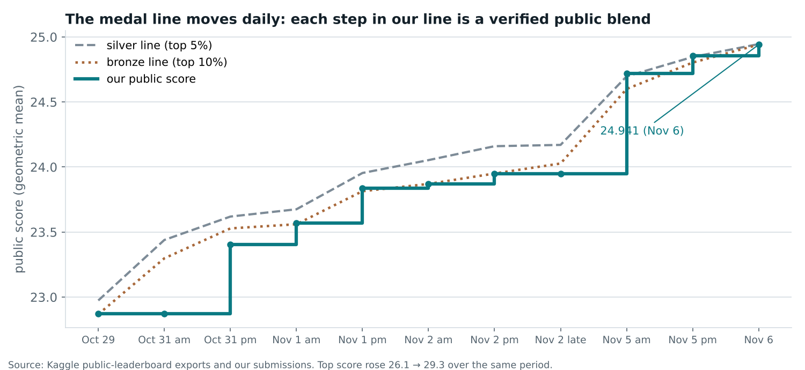

# Quantum Circuit Compilation: Field Notes

What I learned in a Kaggle competition, **Verifiable Quantum Circuit Compilation** (Oct 2026 – Jan 2027), about where the cost of a useful quantum computation really comes from.

The task: make three fault-tolerant quantum circuits cheaper while passing official verifiers. My goals were a medal **and** a working understanding of real-world quantum algorithm optimization. I worked with Claude as a research partner: profiling circuits, running verifiers and searches, and reading the forum.

- 📘 [Lessons](lessons.md): eight principles, each with the evidence behind it
- 🚫 [Negative results](negative-results.md): ten ideas we measured and closed, and why
- 📖 [Glossary](glossary.md): Toffoli, magic state, measurement-based uncomputation, DQI, DF-THC and more
- 🔗 Competition: [kaggle.com/competitions/google-verifiable-quantum-circuit-compilation](https://www.kaggle.com/competitions/google-verifiable-quantum-circuit-compilation)

 

---

## 🧾 Three circuits, three bills

Each task is scored as *baseline cost ÷ your cost*; the final score is the geometric mean of the three. Only non-Clifford gates, qubits and accuracy are priced.

| Task | What it is | Cost formula | Best public circuit (Nov 6) |
|---|---|---|---|
| **invsqrt** | A phase oracle e2πi/√x used in chemistry simulation | Q × C, where C = Toffolis + T/4 | 62 qubits, ~1,281 Toffolis, 41 rotations; uses 99.93% of its error budget |
| **DQI** | A Reed–Solomon decoder over GF(2¹²) inside *Decoded Quantum Interferometry* | R × Q² × T | ~892 qubits, ~395,000 Toffolis per shot; R rises with every failed shot |
| **Chemistry** | A DF-THC block encoding of the FeMoco Hamiltonian (76 orbitals) | λeff × T × Q | 427 qubits, ~15,100 Toffolis; two accuracy limits of 20 mHa, met with < 0.01 mHa to spare |

---

## 📈 Results

Our own ideas each moved the score by hundredths of a percent at best (see [negative results](negative-results.md)). Every real step came from finding, re-verifying and combining the best public circuits, then predicting the Kaggle score before submitting.

| Date | Build | Public score | Rank |
|---|---|---:|---|
| Oct 28 | Public source-built blend | 22.649 | 231 |
| Oct 31 | Community blend | 23.403 | ~296 |
| Nov 1 | Public builds + chemistry refits | 23.835 → 23.870 | 137 (bronze) |
| Nov 2 | Product-caching DQI | 23.947 | 233 |
| Nov 4 | Best-per-task blend | 24.720 | 112 (silver zone) |
| Nov 5 | New chemistry table + loaders | 24.856 | 142 |
| Nov 6 | Hybrid: newest invsqrt + chemistry, Kaggle-proven DQI file | 24.941 | 264 (tied with a pack of ~90 teams on the bronze line) |

The top of the board rose from 26.1 to 29.3 over the same period. Medal lines moved 0.3–1.2% per day as each public build was copied by hundreds of teams.

---

## 🧭 Three questions before reaching for a new tool

1. **Does it cut what is charged?** Toffolis, peak qubits or λ. Tools that minimize T-count or depth miss this scoring.
2. **Does the circuit have that kind of slack?** Pebbling needs idle values that are cheap to recompute; a refit needs accuracy budget left.
3. **Is it safe under an unknown seed?** Check measurement-dependent changes on several salts; the final ranking draws a fresh one.

---

## 🙏 Credits

Every score above rests on public, Apache-2.0 notebooks and datasets, re-verified before use. Thank you to **Ehan Mallick** and **Kirill Tymchishin** (invsqrt); **SomeJoint**, **busyaprime**, **yoyobar**, **Syed Asad Ali** and **Ahmed Berat Özer** (DQI); **Lera**, **Ayodeji**, **heliosli**, **Dmitrii Gluzdov**, **Atakan Aldemir**, **Isabe11aM00re** and **Alex Chilton** (chemistry); and **manwithacat** for the daily research briefings, the blend notebook and the fast Rust verifier. Errors in these notes are mine.

Figures come from the official competition verifiers run locally, Kaggle public-leaderboard exports and our own experiment logs. Public scores use about half of the test data; final standings use the other half.
