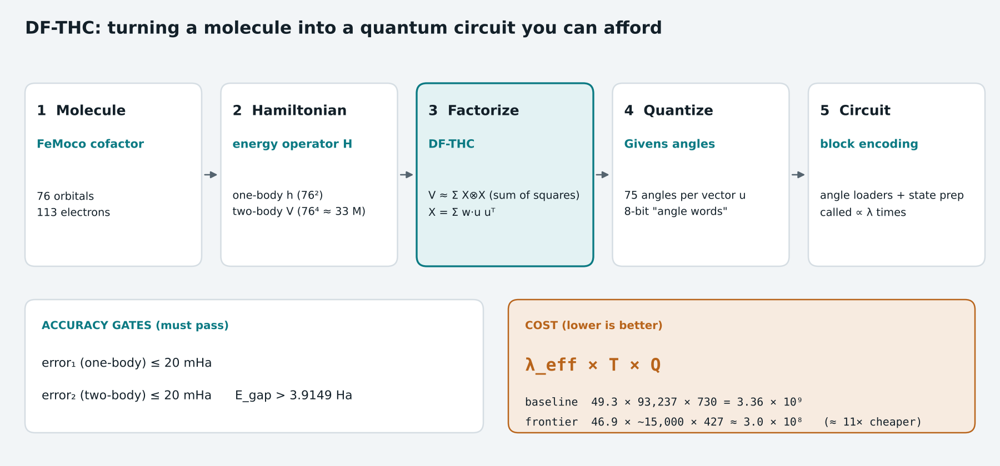

# DF-THC, for quantum chemistry circuits

**DF-THC** (double-factorized tensor hypercontraction) is a way to write a molecule's energy operator as a short sum of simple pieces, so that a quantum computer can load it cheaply. In the competition's chemistry task, the factorization and the circuits that load it together decide the score. Back to the [glossary](glossary.md) or the [overview](README.md).

---

## 1. The goal: a molecule's energy

The task targets **FeMoco**, the iron–molybdenum cofactor at the heart of the nitrogenase enzyme, which fixes nitrogen from the air. Its electronic structure is too entangled for classical methods to get exactly, which makes it a standard benchmark for fault-tolerant quantum chemistry. The model used here has **76 spatial orbitals** and **113 electrons**.

A quantum computer would estimate its ground-state energy with **phase estimation**. Phase estimation calls a circuit that "block-encodes" the Hamiltonian H, and it needs a number of calls proportional to **λ / ε**: λ is a normalization (the size of the pieces H is written in) and ε the target accuracy. So the total cost is roughly

> (number of calls ∝ λ) × (Toffolis per call) × (qubits)

which is exactly the competition's score, **λeff × T × Q**.

## 2. Why the Hamiltonian must be factorized

| Part of H | What it describes | Size for 76 orbitals |
|---|---|---|
| One-body terms hpq | Each electron's kinetic energy and attraction to the nuclei | 76² ≈ 5,800 numbers |
| Two-body terms Vpqrs | Repulsion between every pair of electrons | 76⁴ ≈ **33 million** numbers |

Loading 33 million coefficients into a circuit, at every one of the λ calls, would be hopeless. Instead, V is approximated by far fewer, structured pieces.

## 3. Two ideas, combined

| Idea | What it does | Source |
|---|---|---|
| **Double factorization (DF)** | Writes V as a sum of *squares* of one-body operators, V ≈ Σr (Lr)², then diagonalizes each Lr (the second factorization) so each square acts in its own rotated orbital basis | von Burg et al., 2021 |
| **Tensor hypercontraction (THC)** | Writes the pieces with a small set of shared vectors (rank-one terms u uᵀ), so the circuit loads a short list of vectors and weights | Lee et al., 2021 |

The competition's **DF-THC** format combines them:

- V ≈ Σr,c Xrc ⊗ Xrc, a sum of squares;
- each Xrc = Σb wrbc urb urbᵀ is built from unit vectors u (76 entries each) and weights w;
- the shape (R, B, C) sets how many pieces there are: R groups of B vectors, each reused with C sets of weights.

| Factorization | Shape (R, B, C) | Vectors to load | λeff |
|---|---|---:|---:|
| Provided baseline | (65, 60, 60) | 3,900 | 49.30 |
| Public frontier (Nov 6, 2026) | (8, 143, 44) | 1,144 | 46.89 |

## 4. From vectors to circuits: Givens angles

A unit vector with 76 entries can be built from the first basis vector by **75 Givens rotations** (one 2×2 rotation per orbital pair along a spanning tree). So each vector becomes 75 **angles**, and each angle is stored as an integer **angle word** of a few bits.

- **Angle loaders** are lookup circuits: given an address (which vector), they write its 75 angle words into qubit registers. Their cost is the number of AND products, and teams compete hard on it.
- The Givens rotations themselves cost about 2 × 75 × (2 × bits − 1) Toffolis per call.
- **Fewer bits** means cheaper rotations but larger rounding error. At 8 bits the public fits pass; our 7-bit attempt came out 17× over the error limit.

## 5. What is checked, and what is scored

| Quantity | Meaning | Rule |
|---|---|---|
| error₁ | How well the one-body part is reproduced | ≤ 20 mHa (milli-Hartree) |
| error₂ | How well the two-body part V is reproduced (Frobenius norm) | ≤ 20 mHa |
| Λ | The plain LCU one-norm of the pieces | > 49 |
| Egap | Energy gap from a sum-of-squares bound | > 3.9149 Ha |
| **λeff** | √(Egap · (2Λ − Egap)), the effective normalization | **scored**: multiplies the cost |

Λ itself is around 283–308 for these fits, but the sum-of-squares shift brings the effective normalization λeff down to about 47. That shift is why the energy gap appears in the rules.

## 6. The trade-offs that decide the score

| Lever | Helps | Hurts |
|---|---|---|
| Fewer vectors (smaller R × B) | Fewer loader addresses → fewer Toffolis | Harder to stay under 20 mHa; λ may rise |
| Fewer bits per angle | Cheaper rotations, fewer qubits | Rounding error grows fast |
| Re-fitting the weights | Lower λeff at no circuit cost | Public fits already sit on the limits: both errors within 0.000001 mHa of 20, the gap within 0.000002 Ha of its floor |
| Co-designing table and loaders | Data with structure the loaders can exploit | Has to be built into the fit from the start |

**Result so far:** the public frontier is about **11× cheaper** than the provided baseline (3.0 × 10⁸ vs 3.36 × 10⁹), mostly by shrinking the number of vectors (3,900 → 1,144), the Toffolis (93,237 → about 15,000) and the qubits (730 → 427), while keeping λeff about the same.

**Takeaway:** in quantum chemistry the circuit and the math model are one design problem. A slightly worse factorization (higher λ) can still win if it makes the loading circuits much cheaper.

---

### Further reading
- von Burg et al., "Quantum computing enhanced computational catalysis" (double factorization), [arXiv 2007.14460](https://arxiv.org/abs/2007.14460)
- Lee et al., "Even More Efficient Quantum Computations of Chemistry Through Tensor Hypercontraction", PRX Quantum 2, 030305 (2021), [doi:10.1103/PRXQuantum.2.030305](https://doi.org/10.1103/PRXQuantum.2.030305)
- [Nitrogenase](https://en.wikipedia.org/wiki/Nitrogenase) and [FeMoco](https://en.wikipedia.org/wiki/FeMoco) (Wikipedia)
