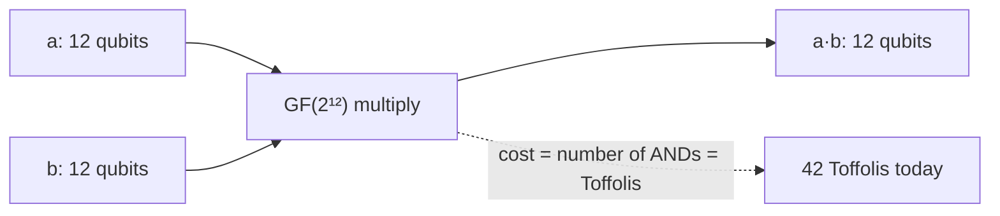

# Galois fields, for quantum circuits

A **Galois field** (or **finite field**), written GF(q), is a finite set of numbers where you can add, subtract, multiply and divide (except by zero), and all the usual algebra rules hold. They are named after Évariste Galois. In these notes they matter because the DQI task's decoder does all its arithmetic in **GF(2¹²)**, and the cost of that arithmetic decides most of the circuit's price. Back to the [glossary](glossary.md) or the [overview](README.md).

| Field | Elements | How you represent an element | Where it shows up |
|---|---|---|---|
| GF(2) | 0, 1 | one bit | Every classical bit; + is XOR, × is AND |
| GF(4) | 0, 1, α, α+1 | 2 bits | Building block for "tower" multipliers |
| GF(8) | 8 elements | 3 bits | The small worked example below |
| GF(2¹²) | 4,096 elements | **12 qubits** | The Reed–Solomon decoder in DQI |

A finite field exists only when its size is a prime power, pⁿ. Everything here uses p = 2, which maps neatly onto bits and qubits.

---

## 1. GF(2): arithmetic on one bit

| + (XOR) | 0 | 1 |   | × (AND) | 0 | 1 |
|---|---|---|---|---|---|---|
| **0** | 0 | 1 |   | **0** | 0 | 0 |
| **1** | 1 | 0 |   | **1** | 0 | 1 |

Note that 1 + 1 = 0: every element is its own negative, so subtraction is the same as addition.

## 2. GF(2ⁿ): bits as polynomials

An element of GF(2ⁿ) is an n-bit string read as a polynomial with 0/1 coefficients. In GF(8), the bits `011` mean x + 1 and `101` means x² + 1.

- **Addition** is bitwise XOR: `011 + 101 = 110`.
- **Multiplication** is polynomial multiplication, then the remainder after dividing by a fixed **irreducible polynomial** of degree n (one that cannot be factored, like a prime number). For GF(8) we use x³ + x + 1, which means "x³ can be replaced by x + 1".

**Worked example in GF(8):** (x + 1) × (x² + 1)

1. Multiply: x³ + x² + x + 1
2. Replace x³ with x + 1: (x + 1) + x² + x + 1
3. Coefficients add mod 2, so x + x = 0 and 1 + 1 = 0: the result is **x²**, or `011 × 101 = 100`.

**Division works too.** Every nonzero element has an inverse: in GF(8), (x + 1)⁻¹ = x² + x, because (x + 1)(x² + x) = x³ + x = (x + 1) + x = 1.

**Powers of x cycle through every nonzero element.** In GF(8): 1, x, x², x+1, x²+x, x²+x+1, x²+1, then back to 1. That cycle has length 2ⁿ − 1 = 7. In GF(2¹²) it has length 4,095, which is why the DQI code is RS(**4095**, 4025).

## 3. GF(4): the smallest interesting multiplication table

Elements 0, 1, α, α+1, with α² = α + 1 (irreducible polynomial x² + x + 1):

| × | 0 | 1 | α | α+1 |
|---|---|---|---|---|
| **0** | 0 | 0 | 0 | 0 |
| **1** | 0 | 1 | α | α+1 |
| **α** | 0 | α | α+1 | 1 |
| **α+1** | 0 | α+1 | 1 | α |

One GF(4) multiplication needs 3 bit-level ANDs. A GF(2¹²) element can be built as a "tower", six GF(4) digits, so a GF(2¹²) multiply can be written as GF(4) products.

---

## 4. Why this matters for quantum cost

| Operation in GF(2ⁿ) | What it is in a circuit | Quantum cost |
|---|---|---|
| Addition | XOR of bits → CNOT gates | **Free** (Clifford) |
| Multiplying by a constant | A fixed linear map → CNOTs | **Free** |
| Squaring | Also linear in characteristic 2 | **Free** |
| Multiplying two unknown elements | Bit products (ANDs) combined by XORs | **One Toffoli per AND** |
| Inversion | Many multiplications | Expensive; good decoders avoid it |

So the Toffoli cost of a field multiplication is the smallest number of ANDs that can compute it: the **bilinear rank** (tensor rank) of the multiplication map.

| GF(2¹²) multiplier | ANDs (Toffolis) |
|---|---|
| Schoolbook (every bit times every bit) | 144 |
| Best known, used by the public DQI decoders | **42** |
| Proven lower bound, via a coding-theory (Griesmer) argument | ≥ 31 |

In the DQI decoder we profiled, about 4,400 of these multiplications made up roughly 44% of all Toffolis. Each AND saved per multiplication would make the whole task ≈ 1% cheaper. We searched for a 41-AND formula with SAT solvers and symmetry, ruled out several families, and found none. A community proof later showed that any *symmetric* formula built on the GF(4) tower needs 14 GF(4) products, which is exactly the 42 in use today.

**Takeaway:** in fault-tolerant quantum computing, finite-field arithmetic is mostly free (additions, constants, squares), and the price is set by one hard combinatorial question: how few ANDs can multiply two field elements.

---

### Further reading
- [Finite field](https://en.wikipedia.org/wiki/Finite_field) and [finite field arithmetic](https://en.wikipedia.org/wiki/Finite_field_arithmetic) (Wikipedia)
- [Reed–Solomon error correction](https://en.wikipedia.org/wiki/Reed%E2%80%93Solomon_error_correction) (Wikipedia)
- Boyar & Find, "Multiplicative Complexity of Vector Valued Boolean Functions": the coding-theory argument behind the lower bound ([arXiv 1407.6169](https://arxiv.org/abs/1407.6169))
