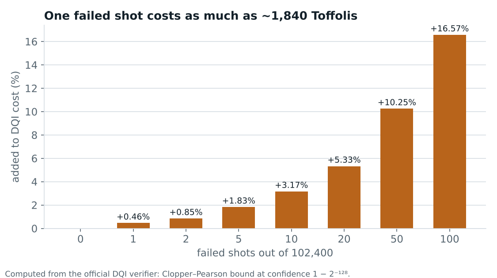

# Lessons: what the circuits taught us

Eight principles from optimizing three fault-tolerant circuits, each with the evidence that taught it. Back to the [overview](README.md).

**One-sentence summary:** practical quantum computing today is mostly a classical optimization problem. You spend a few expensive non-Clifford operations and as few qubits as possible, under strict accuracy budgets, and the hard limits come from algebra.

| # | Principle | What we saw |
|---|---|---|
| 1 | **Non-Clifford gates are the currency.** CNOTs, measurements and classical logic are nearly free; Toffolis, T gates and small rotations are not. | Every task's cost counts only Toffolis/T (plus qubits). On real hardware, magic-state factories take most of the physical qubits. A small rotation costs ≈ 7 Toffolis, set by the error budget, not the angle. |
| 2 | **Qubits count at their peak**, and the peak is usually many brief moments, not one bottleneck. | DQI's cost has Q², so 1 qubit ≈ 900 Toffolis. Its peak is reached in ~200 short moments; 56 of them had no cheap value to free, so pebbling would net only ~+0.01%. |
| 3 | **Uncomputation is half the bill.** Every temporary value must be undone. | Measuring a temporary out and fixing the phase with a CZ ("measurement-based uncomputation") makes cleanup nearly free, yet DQI's undo stages still cost ~2× its forward stages. |
| 4 | **Arithmetic cost is a tensor rank.** | A GF(2¹²) multiplication costs as many Toffolis as the rank of its multiplication tensor: 42 today. Coding theory proves ≥ 31; symmetric SAT searches proved several shortcut families impossible, and a community proof later showed the symmetric GF(4⁶) tower needs exactly 14 GF(4) products (= 42). |
| 5 | **Accuracy is a budget you spend.** | Winning circuits use 99.93% of their error tolerance. The chemistry fits sit 0.0001–0.01 mHa below a 20 mHa limit; our optimality checks found no direction left that lowers λ without breaking it. |
| 6 | **Test across random seeds, not one.** | Our invsqrt gate deletions passed all 3.1 million inputs on the default seed, then failed Kaggle's grader with a 0.5-turn phase error: they were corrections for rare measurement outcomes. In DQI, one failed shot in 102,400 adds 0.46% to cost (as much as ~1,840 Toffolis). |
| 7 | **Big jumps come from new algorithms, not tuning.** | Our local polishing saturated at hundredths of a percent. The leader moved +4.3% in one submission (one task ~13% cheaper); new chemistry tables and loaders gave −2.8% in a day. |
| 8 | **The crowd is a relay.** | Dozens of public, re-verified micro-steps per day moved the public frontier 0.5–1% daily. Best-per-task blends turned them into one submission, and a simple model (local costs + the known DQI draw) predicted our Kaggle scores to 5 decimals. |

## Practical habits that paid off

- **Verify everything with the official verifier** before trusting a score, including public notebooks.
- **Keep a ledger** of every run (score, parent, idea) and of every closed idea with the reason it closed.
- **Prefer parts whose randomness is already known.** Kaggle seeds each DQI file's failure draw by its hash, so reusing a DQI file that Kaggle has already scored removes the risk of an unlucky draw.
- **Profile before optimizing**: per-stage Toffoli and qubit profiles told us where not to dig.
- **Compute a lower bound before a long search**, so you know when to stop.

*Why approximate decoders lose: dropping rarely used decoder branches saved 0.5–4% of Toffolis but cost 5–29% of score, because each failure is priced through a very conservative bound (confidence 1 − 2⁻¹²⁸).*
