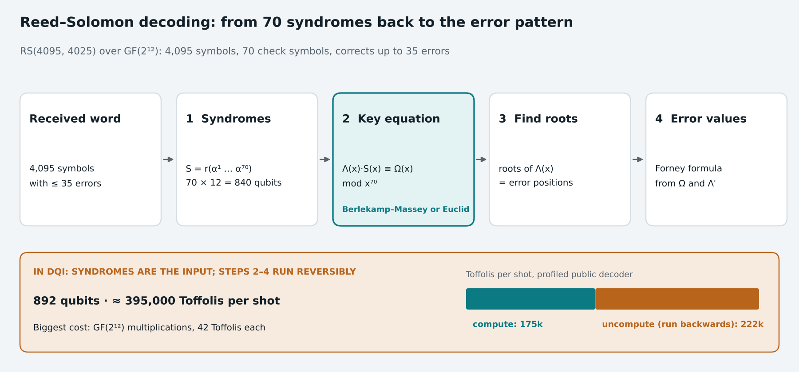

# Reed–Solomon decoding, for quantum circuits

**Reed–Solomon (RS) codes** protect data by storing it as the values of a polynomial over a [finite field](galois-fields.md). They are everywhere in classical computing: QR codes, CDs and DVDs, deep-space probes, RAID storage. In the competition's **DQI** task, a Reed–Solomon *decoder* has to run as a quantum circuit, and that decoder is almost the entire cost of the task. Back to the [glossary](glossary.md) or the [overview](README.md).

---

## 1. The idea in one picture

**Intuition (with ordinary numbers):** a straight line is fixed by 2 points. Write down 5 points on a line instead: (1, 2), (2, 4), (3, 6), (4, 8), (5, 10). If one gets corrupted, say (5, 11), the other four still agree on a single line, so you can spot the bad point and repair it.

Reed–Solomon does the same with polynomials over a finite field:

| | Meaning | In DQI's code |
|---|---|---|
| **k** | Message length: the polynomial has k coefficients | 4,025 symbols |
| **n** | Codeword length: the polynomial is evaluated at n field points | 4,095 symbols (every nonzero element of GF(2¹²)) |
| **n − k** | Redundant "check" symbols | 70 |
| **t = (n − k) / 2** | Errors it can correct | **35** |

Written **RS(4095, 4025) over GF(2¹²)**: each symbol is a 12-bit field element, and up to 35 wrong symbols anywhere in the 4,095 can be found and fixed.

## 2. How decoding works

| Step | What it computes | How |
|---|---|---|
| **1. Syndromes** | 70 numbers S₁…S₇₀ that are all zero if there is no error, and otherwise depend only on the errors | Evaluate the received word at α¹ … α⁷⁰ (α generates the field) |
| **2. Key equation** | An **error-locator** polynomial Λ(x) of degree ≤ 35 and an **error-evaluator** Ω(x), with Λ(x)·S(x) ≡ Ω(x) (mod x⁷⁰) | **Berlekamp–Massey** (an iterative, 70-step algorithm) or the **extended Euclidean algorithm** (polynomial GCD) |
| **3. Find the roots** | Positions of the errors: the roots of Λ(x) | Try every field element (the classical "Chien search") |
| **4. Error values** | What each wrong symbol should be | **Forney's formula**, from Ω and the derivative Λ′ |

All of this is arithmetic in GF(2¹²): additions (free in a circuit) and multiplications (costly).

## 3. Why a quantum algorithm needs a classical decoder

**DQI (Decoded Quantum Interferometry)** is a quantum optimization algorithm. It builds a superposition of error patterns, computes their syndromes, and then must *remove* the error pattern so the remaining state interferes into good solutions. Removing it means recovering the error pattern from the syndrome, which is exactly Reed–Solomon decoding, run **reversibly** and **on a superposition of inputs**.

| What makes the quantum version hard | Consequence |
|---|---|
| Every step must be reversible | Every temporary value is uncomputed: the decoder runs forwards and then backwards |
| It runs on a superposition | Control flow cannot depend on the superposed data, so loops run their worst-case length |
| Inputs carry many errors | Test shots average about 31 of the 35 correctable errors, so there is no cheap "few errors" path |
| Each failed shot is penalized | One failure in 102,400 shots costs as much as about 1,840 Toffolis |

The syndromes arrive as the input: 70 symbols × 12 bits = **840 qubits**. The best public decoders add only about 52 qubits of working space on top (892 in total).

## 4. What it costs

| Decoder | Logical qubits | Toffolis per shot |
|---|---:|---:|
| Published estimate (Khattar et al., 2025; extended-Euclid decoder) | 1,885 | ≈ 5.7 million |
| Best public competition decoders (Nov 2026; Berlekamp–Massey family) | 892 | ≈ 395,000 |

In a public decoder we profiled, about **175,000** Toffolis compute the answer and about **222,000** undo the temporary work. Roughly 44% of all Toffolis are GF(2¹²) multiplications at 42 Toffolis each, which is why a cheaper [field multiplier](galois-fields.md) would be worth so much.

**Takeaway:** many "quantum" algorithms spend nearly all their cost on a classical subroutine made reversible. Making that subroutine cheap is classical algorithm engineering: choosing the decoding algorithm, scheduling memory, and minimizing multiplications.

---

### Further reading
- [Reed–Solomon error correction](https://en.wikipedia.org/wiki/Reed%E2%80%93Solomon_error_correction) and [Berlekamp–Massey algorithm](https://en.wikipedia.org/wiki/Berlekamp%E2%80%93Massey_algorithm) (Wikipedia)
- Jordan et al., "Optimization by Decoded Quantum Interferometry", [arXiv 2408.08292](https://arxiv.org/abs/2408.08292)
- Khattar et al., "Verifiable Quantum Advantage via Optimized DQI Circuits", [arXiv 2510.10967](https://arxiv.org/abs/2510.10967)
